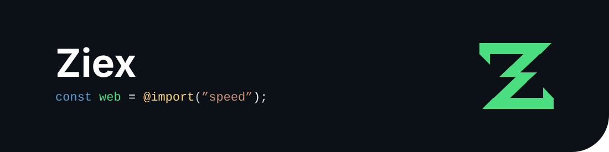
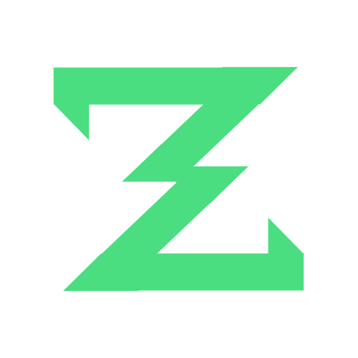
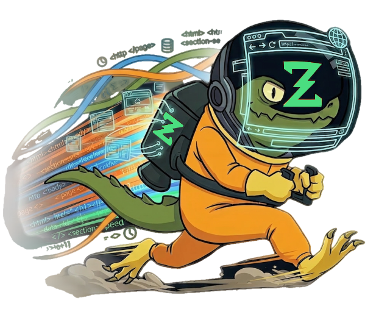

# Ziex Branding

Brand assets for Ziex

Logos, the Ziguana mascot, and banners (static + animated).

## Banners

### Animated banner

`1100 × 275` · animated SVG


| | File | Size | Notes |
|---|---|---|---|
| | [`banner-animated.svg`](./banner-animated.svg) | 7.6 KB | Animated SVG, scales losslessly |
| | [`banner.mp4`](./banner.mp4) | 1.2 MB | Video version |
| | [`banner.gif`](./banner.gif) | 81 KB | GIF version |

### Static banner

`1100 × 275`



| File | Size | Notes |
|---|---|---|
| [`banner.svg`](./banner.svg) | 2.4 KB | Static SVG |

## Logo

`512 × 512`



| File | Size | Notes |
|---|---|---|
| [`ziex-logo-black.svg`](./ziex-logo-black.svg) | 1 KB | Vector logo mark |
| [`ziex-logo-black-bgw.svg`](./ziex-logo-black-bgw.svg) | 1 KB | Vector logo mark |
| [`ziex-logo-colored-bgw.svg`](./ziex-logo-colored-bgw.svg) | 1 KB | Vector logo mark |
| [`ziex-logo-colored.svg`](./ziex-logo-colored.svg) | 1 KB | Vector logo mark |
| [`ziex-logo-white-bgb.svg`](./ziex-logo-white-bgb.svg) | 1 KB | Vector logo mark |
| [`ziex-logo-white.svg`](./ziex-logo-white.svg) | 1 KB | Vector logo mark |

## Ziguana (mascot)

`651 × 452`



| File | Size | Notes |
|---|---|---|
| [`ziex-ziguana.svg`](./ziex-ziguana.svg) | 246 KB | Full-detail vector |
| [`ziex-ziguana.png`](./ziex-ziguana.png) | 416 KB | Raster |
| [`compressed/ziex-ziguana.svg`](./compressed/ziex-ziguana.svg) | 175 KB | Optimized vector |
| [`compressed/ziex-ziguana.webp`](./compressed/ziex-ziguana.webp) | 45 KB | Optimized raster for web |

## Release media

Animated feature GIFs for release notes, rendered from the ziex.dev home page canvases and stored in [`release/<version>/`](./release). They are `1280 × 768` with a `#0d1117` background, so they blend into GitHub's dark mode.

To regenerate them, run the ziex site locally (`http://localhost:3000`), then:

```bash
cd tools/featuregif && npm i && cd ../..
node tools/featuregif/index.mjs --version 0.1.0          # all scenes
node tools/featuregif/index.mjs --version 0.1.0 tooling  # one scene
```

Embed them with `https://raw.githubusercontent.com/ziex-dev/branding/main/release/<version>/<scene>.gif`.

## Usage

- Prefer SVG for crisp rendering at any size.
- Use the green brand color `#4ADE80` for the logo mark.
